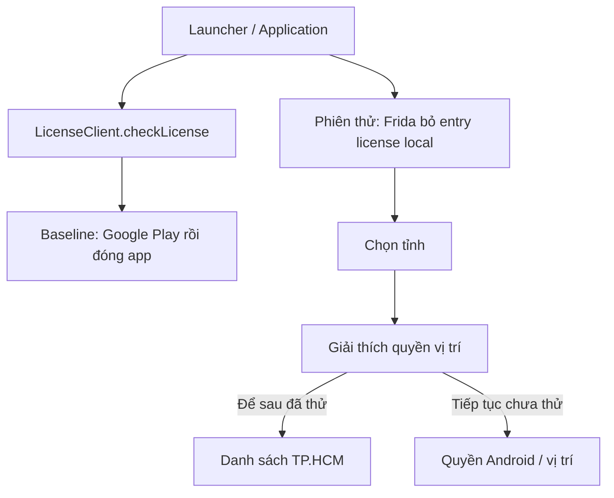
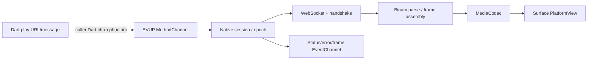

# Flow hoạt động

Liên kết bằng chứng: [investigation.md](investigation.md), [feature-matrix.md](feature-matrix.md). Tĩnh và runtime là hai nguồn riêng; đường nối Dart chưa phục hồi không được xem là call chain đã xác minh.

## Khởi động và license

Quan sát tĩnh: `com/pairip/application/Application.java:9–11` gọi `LicenseClient.checkLicense(Context)`; method tại LicenseClient.java:122–135 khởi tạo kiểm tra. LicenseActivity.java:24–66 có nhánh mở PendingIntent paywall và đóng app.

Quan sát baseline: launcher → kiểm tra license → Google Play đăng nhập → tiến trình app kết thúc. Quan sát có hook: cùng APK → hook chặn checkLicense → màn chọn tỉnh → chọn TP.HCM → disclosure vị trí → chọn Để sau → home.

## TP.HCM: danh sách, chi tiết và yêu thích

Đã tái hiện: home có camera và thumbnail → chạm camera đầu → màn chi tiết → chạm tim → quay lại → tab yêu thích hiển thị camera vừa thêm. Chạm tab bản đồ mở một route riêng có nút quay lại, không giữ navigation bar của shell.

Mã/asset liên quan: `hcm_camera_catalog_repository.dart` @359787, `favorites_store.dart` @750548, `giaothong_image_client.dart` @693759, `camera_detail_presenter.dart` @285823, catalog CG01 và danh sách unavailable 174 ID. Các offset thuộc file libapp.so E-05, không phải địa chỉ method.

Đợt HTTP Dart sau đó xác nhận một luồng live: POST /api/camera/list với provinceKey=tp_hcm → JSON list 900 descriptor → descriptor của 11B trỏ GET Notis snapshot → JPEG HTTP 200 → ảnh trên UI. Metadata có uniqueId, id và sourceId khác nhau; duration=11, flags=(0,0). Bằng chứng E-13/E-14 và [dart-network-findings.md](dart-network-findings.md).

Catalog TP.HCM còn có 19 backupCamera object. Giả thuyết cần kiểm chứng: asset CG01 giải mã được dùng ở bước nào, thứ tự ưu tiên local/live/backup và cache TTL. Việc backend trả schema không chứng minh asset local có cùng schema hoặc nằm trước backend.

## Hà Nội và paywall

Đã tái hiện: đổi tỉnh ở title → chọn Hà Nội → danh sách camera tên/địa chỉ khác TP.HCM. Trong các lần mở camera có màn VIP và quảng cáo; sau đóng quảng cáo đã vào chi tiết. Log có `Intro camera open #2`; chưa kết luận điều kiện paywall theo đếm lần mở hay theo tỉnh.

Runtime tiếp theo xác nhận Flutter gọi native player với WSS host rec01ihanoi.vtscloud.vn, message Hello và epoch 1/2. Socket handshake thất bại với `TLSV1_ALERT_PROTOCOL_VERSION`; UI hiển thị Không tải được hình ảnh, Báo lỗi và Thử lại. Nguồn: playback-redacted.txt, playback-summary.json, after-ad-back. Chưa có frame decode thành công.

Paywall là tính năng sản phẩm, khác license gate Pairip. Hook thử nghiệm chỉ bỏ license gate; không thay đổi trạng thái VIP và không thử giao dịch.

## Native EVUP: call path tĩnh

`MainActivity.s()` đăng ký plugin `p161w1.h` (tên runtime `w1.h`). Plugin tạo:

- MethodChannel `com.genius.cameragiaothong/evup_player`, method `play`/`stop`.
- EventChannel `com.genius.cameragiaothong/evup_player_events`.
- PlatformView `com.genius.cameragiaothong/evup_surface`.

`h.onMethodCall()` đọc `url`, `message` (mặc định Hello), tạo `n(url, handshake, emit)`, gọi `F()`; trả `{textureId:-1, epoch}`. `stop(epoch)` bỏ qua epoch cũ; session mới hủy session trước. Nguồn: h.java:149–218.

`n` có WebSocket listener, gửi handshake khi mở socket, nhận binary, đưa vào handler decode; `w(byte[])` parse header rồi chọn bộ xử lý frame và `x(...)` đẩy tới MediaCodec/Surface. Đã thấy counters/backlog/drop trong code; chưa xác minh đầy đủ wire format hoặc codec cho từng nguồn. Nguồn n.java:265–338, 670–780.

`n.F()` tại 476–487 tạo session/socket; `n.H()` tại 490–519 chọn `video/hevc` hoặc `video/avc` theo header/state đã parse. Đây là hai nhánh decoder trong mã, chưa chứng minh codec thực của stream đang lỗi handshake.

Đã bổ sung runtime Android 13: một nguồn Hà Nội WSS handshake thành công, dùng HEVC decoder và hiện video; xem [android13-playback.md](android13-playback.md). Chưa xác minh đầy đủ lựa chọn renderer/fallback, reconnect/backoff, chiến lược cache, app background và retry. Graph R8 Java có cạnh thiếu; call path trên dựa vào đoạn nguồn trực tiếp, không suy ra từ số cạnh graph.
