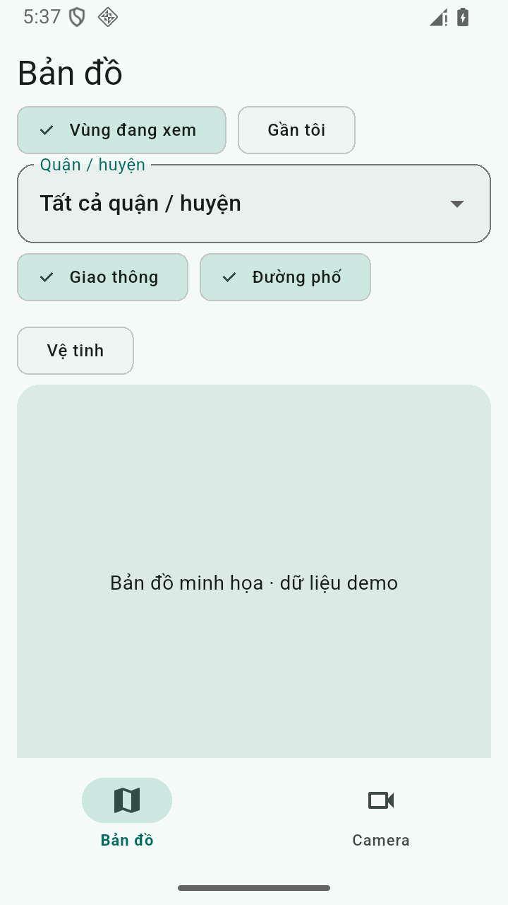

# #40 — Tab Bản đồ mặc định và camera Gần tôi

Ngày: 2026-10-25. Nhánh triển khai: `feat/40-vietmap-discovery`, từ `c0a01b9`. Mã sản phẩm đã kiểm tra: `3b6ca6a`; evidence native cuối: `3c243bd`. Chưa merge vào `main`.

[Spec](../superpowers/specs/2026-10-24-camera-map-discovery-design.md) · [Plan](../superpowers/plans/2026-10-24-camera-map-discovery.md) · [Issue #40](https://github.com/longkunz/lovi-etown/issues/40)

## Phạm vi triển khai

- Navigation **Bản đồ | Camera**: `/` mở Bản đồ, `/cameras` mở Camera, `/map` redirect `/`. Khởi động thông thường không khôi phục tab Camera của phiên trước; deep link giữ đích. Catalog/thumbnail scheduler chỉ tạo khi lần đầu vào Camera, giữ query/quận/scroll qua chuyển tab. Viewer trên root navigator, dùng chung repositories/Quan tâm; Back trực tiếp từ deep link về Bản đồ.
- Khám phá theo viewport (debounce 400 ms) hoặc Gần tôi (1/2/5 km, mặc định 2 km); không xin GPS lúc mở app. Gateway geolocator trả typed result, chỉ xin quyền khi người dùng chủ động; vị trí one-shot có timeout 10 giây. Generation/cancellation loại response API/GPS cũ khi đổi query/tab hoặc dispose, nhưng không hủy thao tác xin quyền chỉ vì permission dialog làm app inactive.
- `GET /v1/map-cameras` xác thực bằng reader/admin key, validation chặt, tối đa 200 kết quả và `hasMore`. PostGIS bbox inclusive, nearby theo khoảng cách rồi ID, loại tọa độ null; REPEATABLE READ read-only giữ rows và catalog metadata nhất quán. Migration 003 thêm expression GiST cho bbox, không thay migration 001/002. [API contract](../api-catalog.md).
- Canvas Vietmap chung cho khám phá/mini/toàn màn hình; SDK-neutral builder/handle cho tests. Street `tm`, hybrid `hm`, traffic `tf` merge sources/layers, giữ nền khi lớp phụ lỗi. Style HTTP dùng client riêng, không gửi reader key; lỗi không lộ URL có map key. Map chỉ tồn tại khi host/route/app đang hiển thị. Bán kính gần tôi là polygon địa lý, không dùng kích thước pixel.
- Thiếu map key vẫn chuyển được sang Camera. Demo có canvas minh họa được gắn nhãn rõ ràng; không phải bản đồ thật. Lỗi API 401 được hiển thị ngay ở Bản đồ, không đợi mở Camera. Kết quả cũ, giới hạn và vùng phủ chưa đầy đủ có thông báo riêng; `verified` dùng đúng vocabulary của backend.

## Kiểm thử tự động và build

Môi trường: macOS, Flutter 3.47.7 / Dart 3.13.5, Node 24.16.0. Database kiểm thử độc lập PostgreSQL 17.11 + PostGIS 3.6.4 tại `127.0.0.1:5433`; phiên này dùng Homebrew vì Docker daemon chưa chạy. Cần tạo extension PostGIS ở schema `public` trước suite, tương đương database khởi tạo sẵn của image Compose. Compose tiêu chuẩn của repo vẫn dùng PostGIS 3.5.

| Kiểm tra | Kết quả |
|---|---|
| Backend `npm run typecheck` | PASS |
| Backend `npm run test:unit` | 59 PASS |
| Backend `npm run test:api` | 21 PASS |
| Backend `npm run test:db` | 15 PASS |
| Flutter `flutter analyze --no-pub` | PASS — không có issue |
| Flutter `flutter test --no-pub` | 231 PASS, 1 conditional skip |
| Android `flutter build apk --debug --no-pub` | PASS |
| iOS `flutter build ios --simulator --no-codesign --no-pub` | PASS |

Suite DB có camera biên bbox, null, khác quận/tỉnh, nearby trong/ngoài bán kính, tie-break ID, limit+1, stale catalog, snapshot nhất quán khi sync commit xen giữa hai read, migration lặp và EXPLAIN trên 20.000 camera. EXPLAIN thực tế dùng `cameras_geom_geometry_gist` cho bbox và `idx_cameras_geom` cho nearby. Không đặt assertion bắt planner phải chọn index cho dataset nhỏ.

Flutter tests kiểm tra client/fixture độc lập với trang catalog, không startup GPS/snapshot, debounce và generation, permission-dialog inactivity, tab ẩn/root viewer, favorites dùng chung, marker/list chọn camera, stale/limit/coverage, 320 dp và text scale 2, style/controller cũ, lớp phụ lỗi và traffic preference giữa các bề mặt. Một test config được skip có chủ đích theo việc có build overrides; không thêm skip cho #40.

Review độc lập theo hai trục spec và standards đã tìm thấy lỗi payload traffic malformed thoát typed error boundary và metadata `verified` bị báo thiếu vùng phủ. Cả hai có regression đỏ trước khi sửa và xanh sau khi sửa. Smoke ảnh thật phát hiện chip chữ trắng trên nền sáng (~1.1–1.3:1); đã sửa màu chữ theo `onSurface` và thêm `textContrastGuideline` (ngưỡng 4.5:1).

Vietmap Flutter 4.1.1 có `Package.swift` chỉ chứa comment, khiến Flutter SPM build thất bại. Project tắt SPM để dùng CocoaPods theo native setup của package; Android minSdk 24/JitPack và iOS usage description foreground đã cấu hình. Không thêm quyền background. Google Maps dependency/config/pods cũ đã gỡ.

Bằng chứng rút gọn: [automated-2026-10-25.txt](camera-map-discovery/automated-2026-10-25.txt). Các lệnh backend được chạy đúng thứ tự unit → API → DB. Test database tạm thời đã dừng sau kiểm tra; không bật service khởi động cùng máy.

Fixture nearby dùng Haversine (bán kính Trái Đất 6.371.008,8 m), khác ellipsoid PostGIS ở sát biên; test fixture chọn điểm cách biên ít nhất 20 m. Kết quả production dùng PostGIS, không lọc từ trang catalog đã tải.

## Quyết định khi thực thi

- Làm trong managed worktree riêng để giữ nguyên checkout `main` và evidence có sẵn. Có thể bỏ nhánh nếu không muốn tích hợp; không tự merge/push.
- Chia theo ownership backend, mobile data, canvas và navigation; dùng HTTP/domain interface đã chốt. Nếu interface lệch thì chi phí là tích hợp lại; full tests cuối kiểm tra toàn bộ các phần cùng nhau.
- Dùng CocoaPods thay SPM vì manifest SDK Vietmap 4.1.1 không sử dụng được. Chi phí là giữ toolchain Pods cho đến khi upstream sửa manifest; cả hai native build đã kiểm chứng.
- Không có finding review bị trì hoãn. Kiểm tra native với key thật chưa chạy, được ghi riêng bên dưới.

## Android smoke — demo, không có key Vietmap

[Ảnh và thao tác tái lập](camera-map-discovery/android-emulator-2026-10-25/commands.txt). Dùng emulator Android API 36 riêng ở `emulator-5558`, read-only, phiên `lovi40`; không chạy app trên điện thoại vật lý. Emulator/session riêng đã đóng sau smoke.

- Cold start: Bản đồ/tab đầu tiên và Vùng đang xem được chọn, không có prompt GPS.
- Chuyển Camera → camera chi tiết → Back về Camera thành công.
- Force-stop app (kiểm tra PID đã biến mất), mở bình thường: về Bản đồ. Screenshot 05 là bằng chứng cold start; screenshot 04 là warm session reopen giữ tab Camera, không được dùng làm bằng chứng cold start.
- Quyền fine/coarse vẫn `granted=false`; không thấy lỗi `flutter:E` hoặc `AndroidRuntime:E` của app.
- Lần boot emulator mới có ANR `com.android.systemui` trước khi tương tác; đã đóng system dialog, không ghi nhận ANR của Lovi. Ảnh 00 lưu sự kiện này.

## Chưa nghiệm thu với dữ liệu native thật

Không có `VIETMAP_API_KEY` hợp lệ trong môi trường này. **Chưa xác minh** tiles đường phố/hybrid, entitlement traffic, marker trên bản đồ thật, pan/pinch và vòng đời native với key thật; chưa chạy nghiệm thu runtime iOS. Android demo smoke và iOS Simulator build không thay thế các kiểm tra này. TalkBack/VoiceOver, profile p95/RAM và permission granted/denied trên cả hai nền tảng vẫn cần nghiệm thu thiết bị. Issue không được coi là nghiệm thu production chỉ từ các test fake.

Cách chạy tiếp: cấu hình backend/reader key theo `mobile/SETUP.md`, triển khai migration/API backend của nhánh này và truyền `--dart-define=VIETMAP_API_KEY=<key>` (hoặc `.env` cục bộ). Build bình thường, không bật demo, rồi chạy các kịch bản nghiệm thu trong spec trên Android và iOS riêng biệt.
