# Liquid Glass Refresh — Mockups & Bảng Bề mặt

Bộ mockup HTML tham chiếu (không phải screenshot Flutter hay nghiệm thu thị giác) và đề xuất bề mặt kính cho đợt làm mới giao diện (refresh) Liquid Glass ứng dụng Lovi Etown.

---

## 1. Ngữ cảnh & Baseline Phân tách Thay đổi

- **Baseline Git Commit:** `a87f44c` (Merge pull request #39 from longkunz/camera-viewer-ui)
- **Local Changes Độc lập đang có (T18 Google Maps Traffic Layer):**
  - Backend: `backend/compose.test.yml`, `backend/src/catalog/catalog.repository.ts`.
  - Android/iOS native configs: `mobile/android/app/build.gradle.kts`, `mobile/android/app/src/main/AndroidManifest.xml`, `mobile/ios/...`.
  - Feature code T18: `mobile/lib/src/features/cameras/presentation/widgets/camera_traffic_map_card.dart`, `camera_traffic_map_viewer_screen.dart`.
  - Quyết định: Giữ nguyên toàn bộ mã nguồn T18; tích hợp các controls và header kính mới mà không phá vỡ hợp đồng T18.
- **Codebase Memory MCP Project:** `Users-admin-Sources-lovi-etown` (generation `2026-10-24T11:40:23Z`, coverage best-effort; không coi metadata là chứng minh đầy đủ mã nguồn).

---

## 2. Bảng Phân loại Bề mặt Kính & Nền đặc (Surface Table)

| Bề mặt (Surface) | Vai trò (`CameraGlassRole`) | Hiệu ứng thị giác | Chi tiết kỹ thuật | Fallback nền đặc (`forceOpaque` / High Contrast) |
|---|---|---|---|---|
| **Thanh Tiêu đề (Catalog AppBar)** | `CameraGlassRole.header` | Kính mờ phủ trên nội dung cuộn | Blur 12dp, thickness 14 (light) / 12 (dark), teal tint nhẹ (`0x1A00796B` / `0x26004D40`), viền sáng mảnh | Nền đặc `SurfaceColor` (Trắng / Xám tối `#1E2F3D`), viền tương phản cao 1.5dp |
| **Thanh Tìm kiếm (Search Field)** | `CameraGlassRole.control` | Viên nang kính (Capsule pill) | Chiều cao 48dp, radius 24dp, input text trực tiếp, nút clear 48×48dp | Nền đặc trắng / tối, viền viền màu chủ đạo, không blur |
| **Nút Chọn Quận (District Picker)** | `CameraGlassRole.control` | Nút viên nang kính + Popover kính | Chiều cao 48dp, popover nổi độc lập với bóng đổ 32dp và bo góc 16dp | Popover nền đặc với phân cách danh sách rõ ràng |
| **Bộ chuyển chế độ (Segmented Control)** | `CameraGlassRole.control` | Khung kính bao quanh các tab Card/Grid/List | Bo góc 24dp, tab đang chọn phủ màu teal nhấn và đổ bóng nhẹ | Khung nền đặc, tab đang chọn có màu tương phản chuẩn WCAG AAA |
| **Nút Sao Quan tâm nổi (Star FAB)** | `CameraGlassRole.control` | Nút tròn kính 48×48dp góc phải thumbnail | Bo tròn 24dp, viền kính mỏng, icon sao vàng nổi bật | Vòng tròn nền đen đặc 70% / xám đậm, viền rõ ràng |
| **Header Bottom Sheet** | `CameraGlassRole.sheetHeader` | Bề mặt kính phân cách phần media bên dưới | Blur 18dp, bo góc trên 24dp, nút Đóng (X) và Sao (★) dạng `embedded` không lồng kính | Nền đặc bo góc 24dp trên, đường kẻ phân cách rõ |
| **Khung Ảnh Snapshot / Video Live** | *Nền đặc (Media)* | **TUYỆT ĐỐI KHÔNG DÙNG KÍNH** | Hiển thị sắc nét 100%, không đi qua blur/refraction/shader | Nền đen `#000000` tiêu chuẩn |
| **Thẻ Bản đồ Mini (`CameraTrafficMapCard`)** | *Nền đặc / Overlay* | Bản đồ Google Maps hiển thị nguyên bản; chỉ controls dùng kính/nền đặc | Controls overlay góc trên 48×48dp với `forceOpaque` đảm bảo tương thích platform view | Nền đặc cho toàn bộ cụm controls |
| **Viewer Toàn màn hình** | `CameraGlassRole.header` / controls | Thanh điều khiển nổi trên nền tối | Nền tối `#060A0D`, top bar kính mờ tối màu, nút đóng 48×48dp | Nền đen đặc `#101A22` |

---

## 3. Bộ Mockup Trực quan (Light / Dark)

### 3.1 Danh mục Camera (Catalog Grid) & Thanh tìm kiếm
| Light Mode | Dark Mode |
|---|---|
| 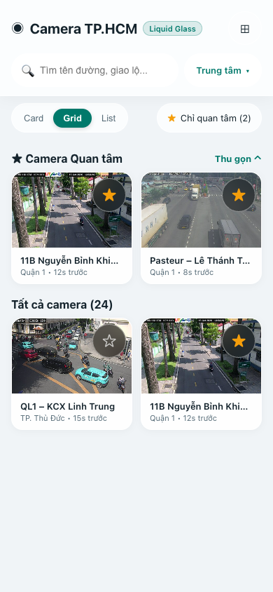 | 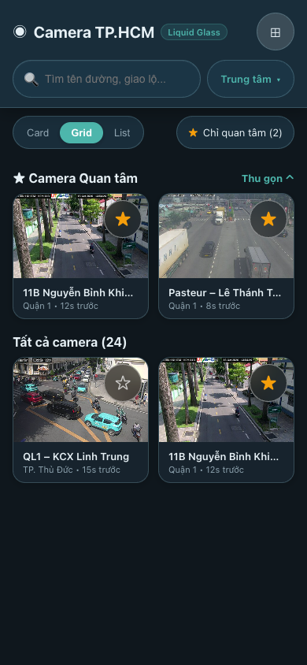 |

### 3.2 Popover Chọn Quận/Huyện (District Picker Open)
| Light Mode | Dark Mode |
|---|---|
| 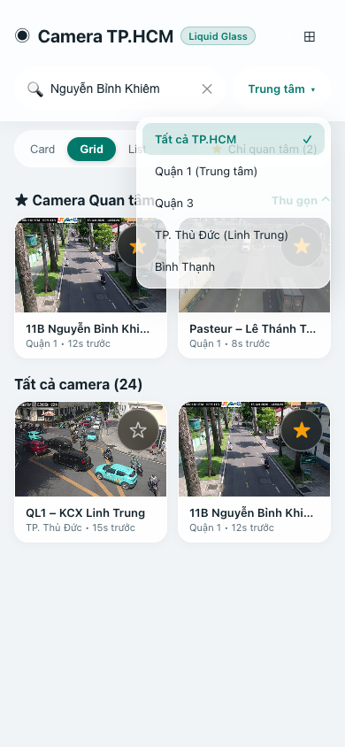 | 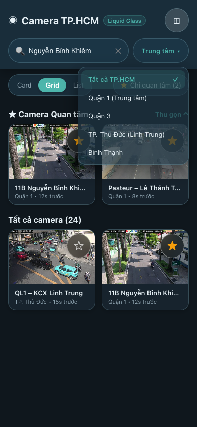 |

### 3.3 Bottom Sheet Chi tiết Camera (Snapshot + Mini Map)
| Light Mode | Dark Mode |
|---|---|
| 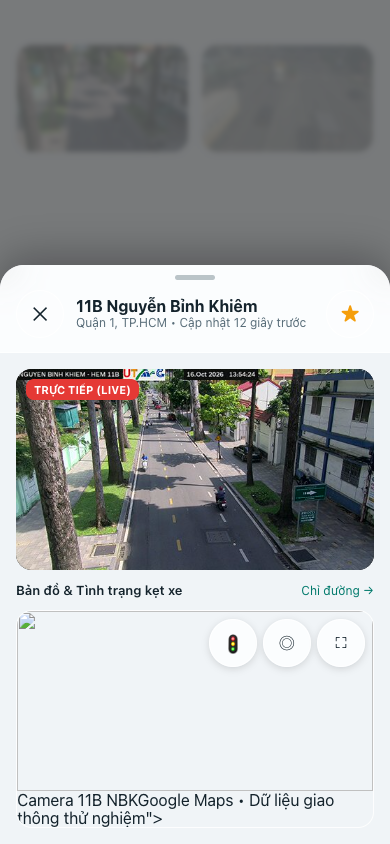 | 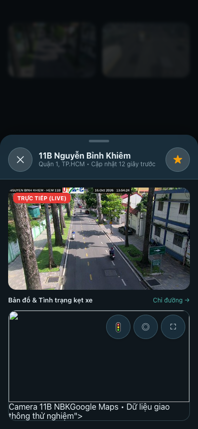 |

### 3.4 Trình xem Ảnh Toàn màn hình (Fullscreen Viewer)
| Chế độ Dọc (Portrait) | Chế độ Ngang (Landscape) |
|---|---|
| 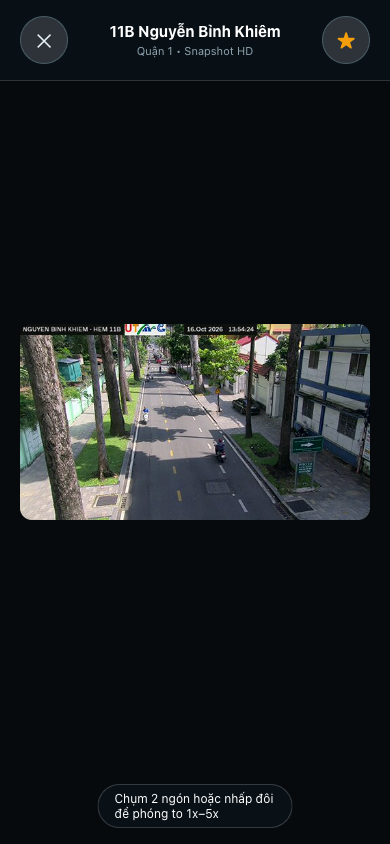 | 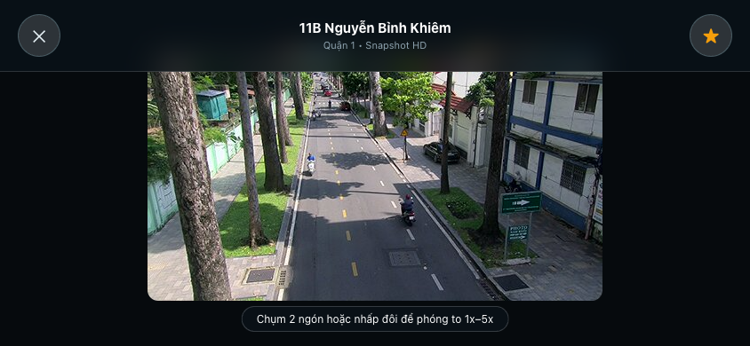 |

### 3.5 Bản đồ Toàn màn hình & Lớp Giao thông Kẹt xe (Traffic Layer)
| Light Mode | Dark Mode |
|---|---|
| 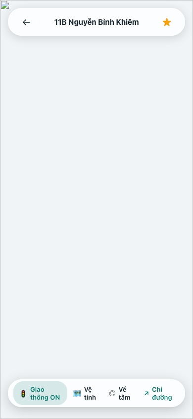 | 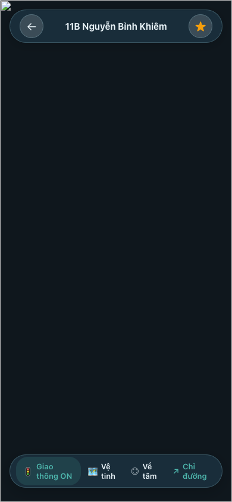 |

### 3.6 Chế độ Dự phòng Nền đặc (Opaque Fallback / High Contrast)
| Light Opaque Fallback | Dark Opaque Fallback |
|---|---|
| 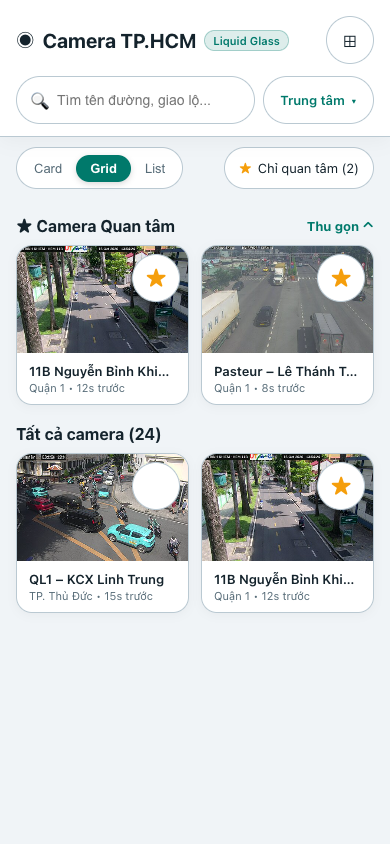 | 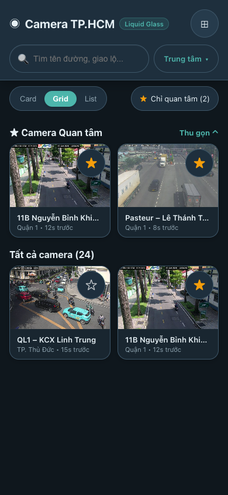 |

---

## 4. Bảng Tokens Thiết kế Bổ sung

```dart
// Spacing & Sizes
static const double tapTargetMin = 48.0;
static const double controlHeight48 = 48.0;
static const double controlHeight42 = 42.0;

// Corner Radii
static const double radiusControl12 = 12.0;
static const double radiusCard16 = 16.0;
static const double radiusSheet24 = 24.0;
static const double radiusCapsule24 = 24.0;

// Glass Blur & Thickness
static const double glassBlurChrome12 = 12.0;
static const double glassBlurSheet18 = 18.0;
static const double glassThicknessHeader14 = 14.0;
static const double glassThicknessControl8 = 8.0;
```

## Cập nhật review 2026-10-24

Các thông số/bố cục ở bảng trên là tham chiếu mockup, không phải hợp đồng API hiện hành hoặc kết quả đo thiết bị. Code thật ở CameraUiTokens và CameraGlassTheme; chỉ có 3 role header/control/sheetHeader. Picker hiện dùng modal bottom sheet. Map controls/header dùng nền đặc; viewer media giữ dark settings cả khi app dùng light theme. Chưa có bộ screenshot app trước/sau hoặc biên bản người dùng duyệt mockup có thể đối chiếu. Xem [báo cáo review](../liquid-glass-refresh-verification.md).
